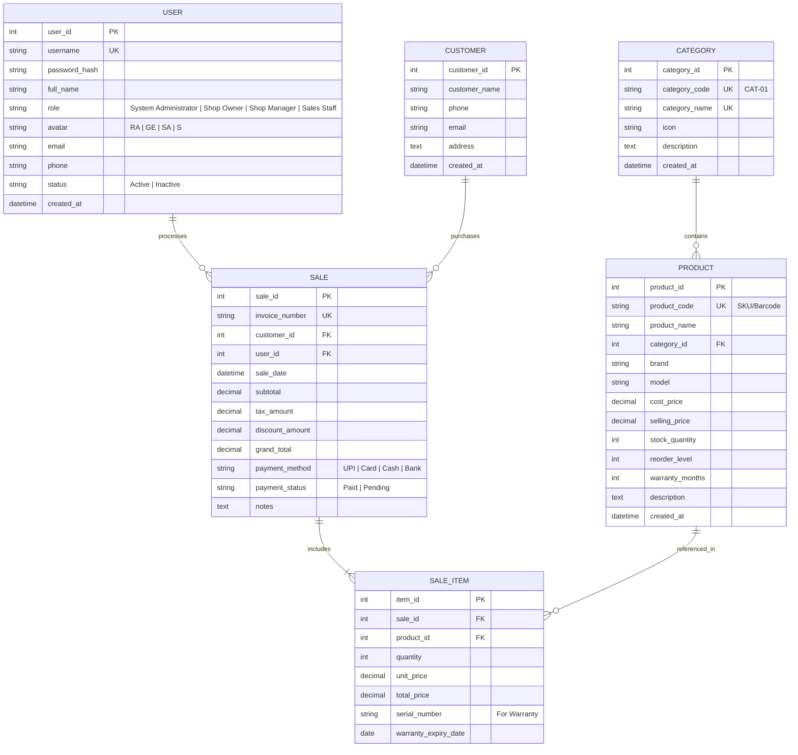

# Electrodesk - Electronics Shop Management System

A complete, modern, functional, and user-friendly web-based **Electronics Shop Management System** built with **Python Flask**, **Bootstrap 5**, **HTML5/CSS3/JavaScript**, and **MySQL** (with zero-dependency SQLite fallback for immediate local execution).

Designed specifically for electronics retail outlets, computer stores, mobile phone shops, and consumer electronics distributors across India.

---

## 🌟 Key Features & Functional Modules

### 1. Modern UI Template & Design System
- **Dark-Navy Fixed Sidebar** (`#0B1B3A` – `#0F2147`), collapsible, with brand block (lightning-bolt logo in a rounded blue tile).
- **Navigation Groups** with small uppercase letter-spaced labels: `OVERVIEW`, `INVENTORY`, `SALES`, `ADMINISTRATION`.
- **Active Navigation Indicator**: Rounded pill with blue left accent border.
- **Pinned User Block**: Profile card pinned at the bottom showing user avatar, name, blue role, and direct Logout button.
- **Light Top Bar**: Calendar icon with today's date (`18 Nov 2026`), low-stock alert bell with red count badge, and quick user profile chip.
- **Card Aesthetics**: 16px border-radius (`rounded-4`), soft border and drop-shadows.
- **KPI Summary Cards**: Uppercase label, large primary metric, muted context note, and coloured icon tiles (navy, blue, green, red).
- **Typography & Polish**: Clean Inter font typography, smooth transitions, and mobile responsiveness.

### 2. Role-Based Access Control (RBAC) & Users
Supports 4 distinct operational roles:
- **Ram** (`admin`) – *System Administrator* – Avatar `RA`
- **Geetha** (`geetha`) – *Shop Manager* – Avatar `GE`
- **Sai** (`sai`) – *Sales Staff* – Avatar `SA`
- **Suresh** (`suresh`) – *Shop Owner* – Avatar `S`

Includes a comprehensive **Permission Matrix** (`10 Modules × 4 Roles`) displayed directly in the *Users & Roles* administrative module.

### 3. Indian Currency (₹ INR) & GST Tax Compliance
- **Indian Rupee Formatting**: Formatted via a shared formatter (`Intl.NumberFormat('en-IN', {style:'currency', currency:'INR', maximumFractionDigits:0})`), displaying realistic Indian values like `₹31,72,747`.
- **GST 18% Compliance**: Real-time tax computation split equally into **CGST 9%** + **SGST 9%**.
- **Standardized Dates**: Formatted throughout the application as `18 Nov 2026`.

### 4. Point of Sale (POS) & Automated Billing
- **Fast Product Lookup**: Instant keyboard search by product name, SKU, barcode, brand, or model.
- **Department Quick Pills**: Filter instantly across product departments (Smartphones, Laptops, Audio, Displays, Smart Home, Gaming).
- **Cart Management**: Reactive quantities, unit price, stock limit enforcement, and serial number input per item.
- **Automatic Billing**: Subtotal, CGST (9%), SGST (9%), discount deductions, and grand total.
- **Multi-Payment Options**: UPI / QR Code, Cash, Credit/Debit Card, and Net Banking.
- **Inline Customer Creation**: Add new customers directly from the register modal.
- **Atomic Stock Deductions**: The whole checkout (sale, items, stock, movements) runs in ONE database transaction with a guarded stock update – no partial sales and no overselling.
- **Server-side Pricing**: Tax, discounts, coupons and exchange value are recomputed on the server; values sent by the browser are never trusted.

### 5. Professional Tax Invoices & Printing
- **A4 / Letter Print Layout**: Ready for thermal/laser printers or PDF export (`window.print()`).
- **GSTIN & Store Details**: Electrodesk branding, Hyderabad flagship store address, contact info, and GSTIN `36AAACE4812K1Z8`.
- **Itemized Breakdown**: Quantities, unit rates, serial numbers / IMEIs, warranty durations, CGST 9% and SGST 9% details, customer details, and "Sold by" staff signature.
- **Custom `@media print` Rules**: Automatically hides navigation bars, topbars, and action buttons during print.

### 6. 2-Column Category Grid Cards
- Category cards laid out in a responsive 2-column grid.
- Each card features:
  - Category icon and code (`CAT-01`, `CAT-02`, etc.)
  - Category name and description
  - Edit and Delete modal actions
  - Three-metric summary footer: **Products count**, **Total Units**, and **Total Stock Value (₹)**.

### 7. Executive Reports & 14-Day Revenue Analytics
- **Dual Tab View**: "Sales report | Inventory report".
- **Revenue Bar Chart**: Dark-navy bar chart showing daily revenue for the last 14 days.
- **Summary Metrics**: Total Orders, Gross Revenue (₹), COGS (₹), Gross Profit (₹), Profit Margin (%), and Average Order Value (AOV).
- **Top 10 Best Sellers & Category Breakdown**: Detailed performance tables with 1-click **Print report** button.

### 8. Dedicated Electronics Warranty Tracking
- **Serial Number / IMEI Lookup**: Search by serial number, invoice reference, product name, or customer phone.
- **Automated Expiry Calculation**: `warranty_expiry_date = sale_date + warranty_months`.
- **Status Badges**: `Active` (green badge with days remaining), `Expiring Soon` (yellow badge), `Expired` (grey badge).
- **Warranty Verification Certificate**: Printable service modal for customer service claims at authorized service centers.

---

## 🗄️ Database Architecture (core ERD – 6 of the 20 tables)

> The full schema has **20 tables** (see `schema_mysql.sql` / `init_db.py`): the 6 below plus STOCK_MOVEMENT, WARRANTY_CLAIM, CREDIT_NOTE, CUSTOMER_PAYMENT, SUPPLIER, PURCHASE_ORDER(+ITEM), QUOTATION(+ITEM), REPAIR_TICKET, EXPENSE, DAILY_CLOSING, AUDIT_LOG and STORE_SETTING.



---

## 📁 Clean Folder Structure

```
electronics_shop_system/
│
├── app.py                     # Main Flask application with routes, filters & RBAC
├── config.py                  # Store settings, GST rates (18%), currency (₹), DB config
├── db.py                      # Unified database access layer (MySQL & SQLite fallback)
├── init_db.py                 # Schema creator and sample data seeder for 4 users & INR products
├── schema_mysql.sql           # Complete MySQL DDL schema (6 tables, constraints & indexes)
├── seed_data_mysql.sql        # Realistic Indian electronics seed data with INR pricing
├── electrodesk.db             # Local SQLite database pre-seeded with sample data
├── requirements.txt           # Python package dependencies
├── test_app.py                # Automated regression suite (35 tests, uses a temporary database)
├── README.md                  # Comprehensive documentation and execution guide
│
├── static/
│   ├── css/
│   │   └── style.css          # Dark-navy sidebar, 16px cards, KPI tiles, print rules
│   ├── js/
│   │   ├── main.js            # Shared Intl.NumberFormat INR currency formatter & alert timers
│   │   └── pos.js             # Reactive POS, live CGST (9%) + SGST (9%), and checkout
│   └── images/
│       └── logo.svg           # Electrodesk lightning-bolt logo in rounded blue tile
│
└── templates/
    ├── base.html              # Dark-navy sidebar, topbar with date & low-stock bell, user chip
    ├── login.html             # Electrodesk branded login with 4 one-click demo role buttons
    ├── dashboard.html         # Executive dashboard with 4 KPI tiles, charts & restock modal
    ├── pos.html               # Point of Sale & automated billing register
    ├── invoice.html           # Professional printable GST tax invoice with CGST/SGST split
    ├── invoices_list.html     # Historical sales invoices list with filters
    ├── products.html          # Product catalog management (CRUD, INR pricing, reorder)
    ├── categories.html        # 2-column category grid cards with Products/Units/Value footer
    ├── inventory.html         # Inventory valuation & stock adjustment modal
    ├── customers.html         # Customer CRM directory
    ├── customer_detail.html   # Customer purchase history & active warranties
    ├── warranty.html          # Electronics warranty tracking center with serial lookup
    ├── reports.html           # Sales & Inventory tabs with 14-day revenue bar chart
    └── users.html             # User administration & 10x4 permission matrix
```

---

## 💻 Windows 11 Installation & Execution Commands

### Prerequisites
- Windows 11 (64-bit)
- Python 3.10+ installed
- (Optional) MySQL Server 8.0+ or XAMPP (App defaults automatically to zero-setup SQLite fallback)

### Step 1: Open PowerShell / Terminal
```powershell
cd "path\to\electronics_shop_system"
```

### Step 2: Install Python Dependencies
```powershell
pip install -r requirements.txt
```

### Step 3: Initialize Database (Quick SQLite Default)
```powershell
python init_db.py
```
*(This creates `electrodesk.db` and populates the 4 users, categories with CAT codes, realistic INR electronics, and sample sales).*

### Step 4: Run the Application
```powershell
python app.py
```

### Step 5: Access in Your Browser
Open your browser and navigate to:
👉 **`http://127.0.0.1:5000`**

---

## 🔑 Default Login Credentials

| Name | Role | Username | Password | Avatar |
| :--- | :--- | :--- | :--- | :--- |
| **Ram** | System Administrator | `admin` | `admin123` | `RA` |
| **Geetha** | Shop Manager | `geetha` | `geetha123` | `GE` |
| **Sai** | Sales Staff | `sai` | `sai123` | `SA` |
| **Suresh** | Shop Owner | `suresh` | `suresh123` | `S` |

*(Tip: On the login page, click any of the 4 demo login buttons to sign in instantly with one click!)*

---

## ⚙️ Configuration & Security Notes

| Environment variable | Purpose | Default |
| :--- | :--- | :--- |
| `SECRET_KEY` | Flask session signing key | random key generated once and stored in `.secret_key` |
| `FLASK_DEBUG` | Debug mode (never enable in production) | `False` |
| `HOST` | Bind address (`0.0.0.0` to expose on the network) | `127.0.0.1` |
| `OWNER_APPROVAL_PIN` | PIN for discounts above 10% | `9999` – **change it** |
| `DB_TYPE` / `MYSQL_*` | `mysql` to use MySQL (`python init_db.py --mysql` first) | `sqlite` |

* The login page still offers one-click demo logins and the seeded accounts use demo passwords – remove/rotate them before real use.
* JSON backups contain password hashes: store them privately.
* Restore replaces **all** data with the backup's contents (all-or-nothing); it no longer re-seeds demo data.

## 🧪 Running Automated Tests

Run the complete test suite:
```powershell
python test_app.py
```

The tests cover checkout tampering, atomic rollback, returns, dues, quotations, backup/restore, daily closing, GST, user rules and the MySQL schema splitter.
